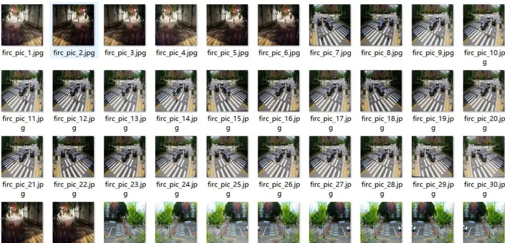
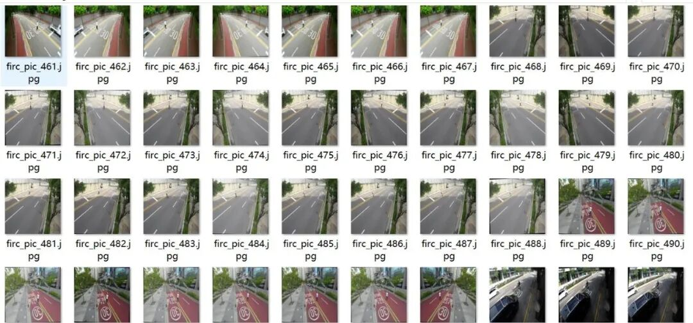
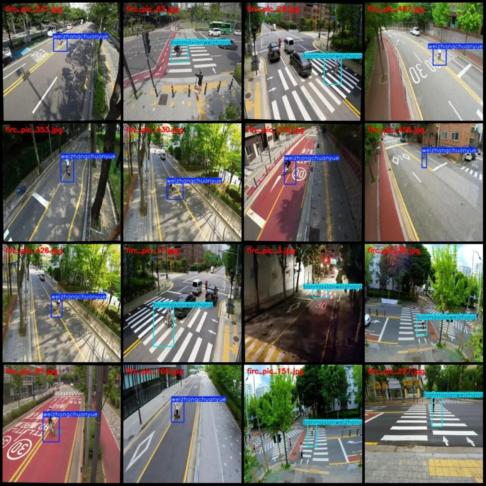
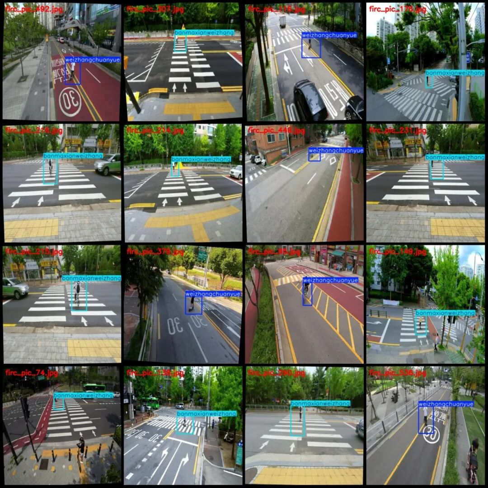
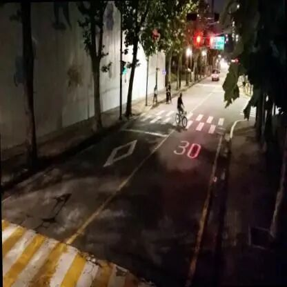
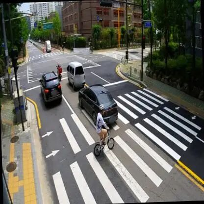
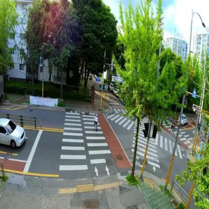

# Pedestrian Crossing Violation Detection Dataset VOC+YOLO format with 562 images in 2 categories with enhanced data.

Note: The dataset contains a large number of enhancements, and it seems that the original image is only about 20.

Dataset format: Pascal VOC format + YOLO format (txt file without split path, only containing jpg images and corresponding VOC format xml files and yolo format txt files)

Number of images (number of jpg files): 562

Number of annotations (number of xml files): 562

Number of annotations (number of txt files): 562

Labeling category count: 2

Label category names (Note that the order of categories in the YOLO format does not correspond to this, but is based on the labels folder's classes.txt): ["banmaxianweizhang", "weizhangchuanyue"]

Corresponding Chinese category name: ["Zebra Crossing Violation", "Illegal Crossing"]

Number of boxes labeled in each category:

banmaxianweizhang frame count = 260

weizhangchuanyue frame count = 302

Total frame count: 562

Number of images per category:

banmaxianweizhang's possession of images = 260

Weizhangchuanyue's possession of images = 302

Image resolution: 416x416

Using labelImg:

Annotation rules: Draw a rectangle around the category.

Important Notice: The dataset does not have separate training, validation, and test sets; you need to partition them yourself.

Special : This dataset does not guarantee the accuracy of the trained models or weight files.

Image Preview:

Annotation example:

Single image:

"

## Payment

Here is a pay link on Stripe ( https://buy.stripe.com/3cs8yP7sY87d0vu9AB ). Please contact me lonlonago@foxmail.com after funding $89, and I will send you a complete data files , thank you!

